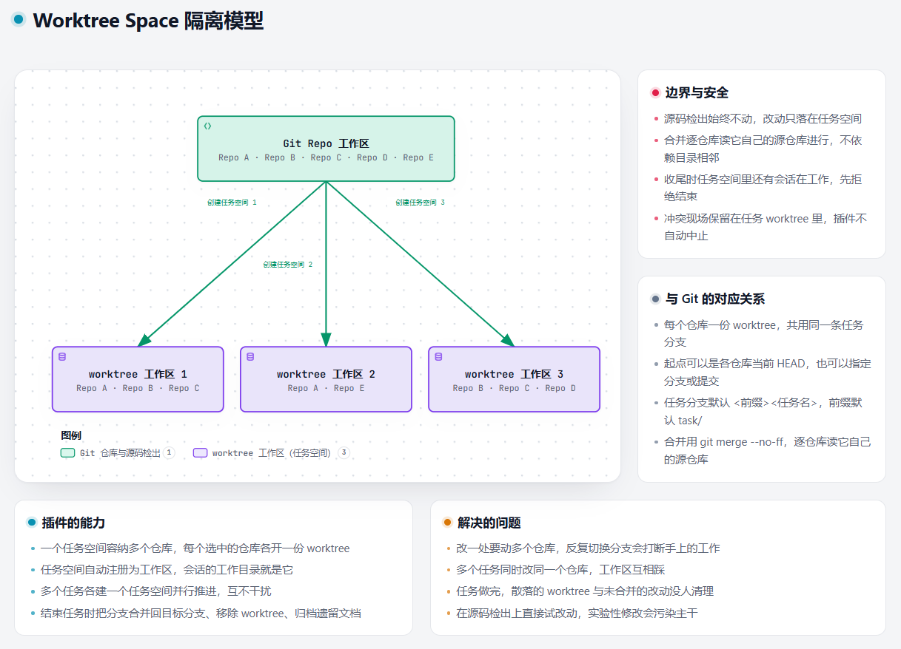
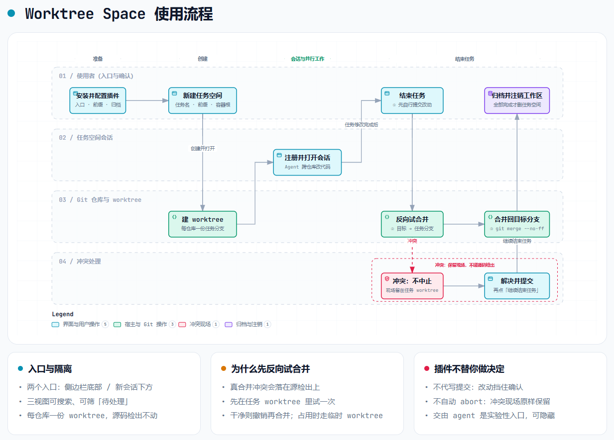
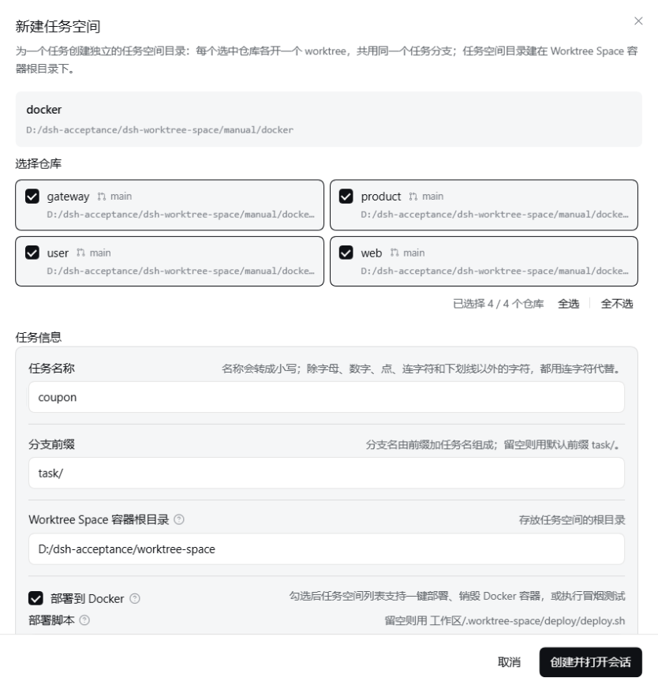
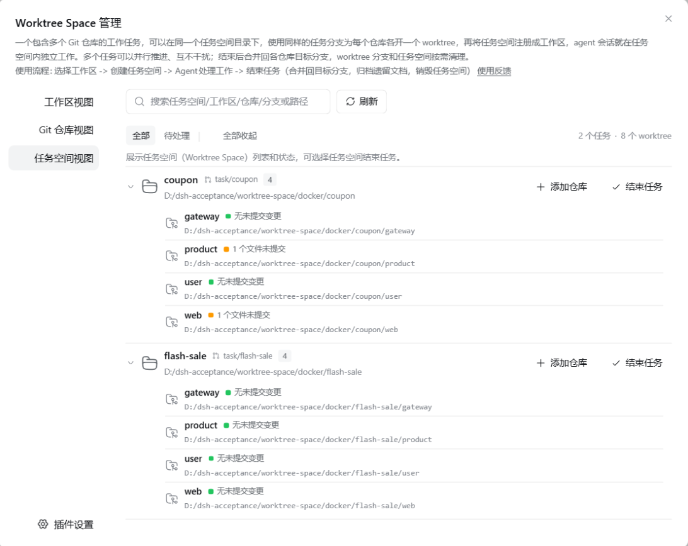
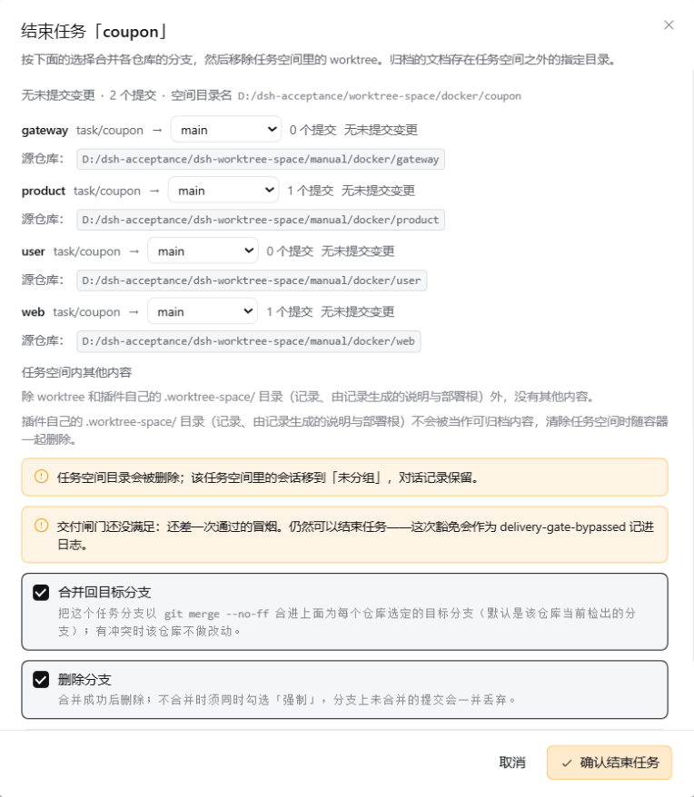

# Worktree Space

**简体中文** · [English](README.en.md) · [更新日志](CHANGELOG.md)

Worktree Space：一任务一空间，工作多路并行。把一个涉及一个或多个 Git 仓库的工作任务放进独立的任务空间目录——参与的每个仓库都在同一个任务分支上各开一个 worktree；任务空间自动注册为 DSH 工作区，会话直接在任务空间里开工；多个任务各建一个任务空间并行推进、互不干扰。建空间时可以定下**这个任务要不要部署验收**，勾了它，一条通过的冒烟记录就是收尾合并的闸门。任务结束时把任务分支合并回目标分支、移除 worktree，并把空间里遗留的文档归档到指定目录；也可以把未处理的提交和合并冲突交给一个 agent 会话处理。

两条路各有侧重，可以只看其中一条：**在面板上手动点完全程**（[使用](#-使用)），或者**让 Agent 用工具自动编排**（[高级用法](#-高级用法让-agent-全自动编排)）。完整步骤、异常流程与错误码都在 [《Worktree Space 使用指南》](USAGE.md)。





📺 **视频介绍**：[Worktree Space 插件介绍（B 站）](https://www.bilibili.com/video/BV17Mn56dECu)

> [!IMPORTANT]
> **Beta（实验性）**：把提交和合并冲突交给 agent 处理的功能处于实验性验证阶段，行为可能继续调整；它**默认
> 显示**，如需隐藏这两个入口，将插件配置里的「交由 agent 解决冲突入口」设为「隐藏」（见[实验性一节](#-实验性把提交与冲突交给-agent)）；
> 本文档其余部分描述的是不借助 agent 的标准流程。遇到问题请在
> [GitHub Issues](https://github.com/kangtsang/dsh-worktree-space/issues) 里反馈。

## 📑 目录

- [🚀 安装](#-安装)
- [✨ 功能](#-功能)
- [📂 任务目录结构](#-任务目录结构)
- [🔧 环境要求](#-环境要求)
- [🔐 权限与失败边界](#-权限与失败边界)
- [🛠️ 使用](#-使用)　**面板手动流程**：[⚙️ 配置](#-配置) · [➕ 创建](#-创建-worktree-space) · [🗂️ 管理](#-管理-worktree-space) · [🚢 部署验收](#-部署验收) · [🏁 结束](#-结束-worktree-space)（[组合行为](#各选项组合的行为)）
- [🤖 高级用法：让 Agent 全自动编排](#-高级用法让-agent-全自动编排)
- [🤖 实验性：把提交与冲突交给 agent](#-实验性把提交与冲突交给-agent)
- [📝 操作日志](#-操作日志)
- [📄 配套文档](#-配套文档)

## 🚀 安装

**网页端，从命令行安装：**

```sh
dsh plugin --profile web add dsh-worktree-space
```

卸载：`dsh plugin --profile web remove dsh-worktree-space`；更新时先卸载再重新安装。

**桌面端在插件管理页里操作**：侧边栏 → **插件**，在「插件包名」填 `dsh-worktree-space`，点「安装」；
卸载时在插件列表里点开 **Worktree Space**，进「插件详情」页，右上方点「卸载」按钮。

## ✨ 功能

- **从会话里建任务空间。** 勾选要参与的仓库（默认全选）、给任务起名、定分支前缀、指定任务空间放哪。
  每个参与的仓库都会得到一份位于 `<分支前缀><任务名>` 的 worktree（前缀默认 `task/`），起点可以是各仓库
  当前的 HEAD，也可以指定某个在所有选中仓库里都存在的分支或提交。
- **唯一一项交付选择：这个任务要不要部署验收。** 任务信息最后就是一个勾选框 —— **部署到 Docker**，
  勾上后会多出一个 **部署脚本** 输入框（留空则用 `工作区/.worktree-space/deploy/deploy.sh`）。
  它之所以在建的时候就问，是因为**交付策略只在创建时落一次，事后没有入口能加、能改**：没勾等于定了
  「这个任务不做验收」，之后也不会有任何东西再提起这件事。反过来，勾了却找不到可用的入口脚本时
  **创建会被直接拒绝**，而不是留一个永远部署不起来的任务空间。
  其余收尾时的决定 —— 合到哪条分支、要不要删分支、冲突怎么办、遗留文档怎么处理 —— 都不在这里预定，
  留给结束任务那一刻当场决定。
- **部署验收**（勾了才有）。任务空间自带一个部署根：源码根的 `.worktree-space/deploy/` 会被复制进来，
  入口脚本提供 `up`（起环境、写验收地址）与 `smoke`（跑冒烟、把结果写进 `.state.json`）。
  每个任务的环境身份互不相同，任务之间不会互相顶掉。**合并之前有一道闸门**：`<部署根>/.state.json`
  里没有一条 `result: "pass"` 的 `lastSmoke`，合并就被拒；面板会问「冒烟还没过，仍要结束吗？」，
  这份豁免只有人能给。
- **注册成工作区**，名字是 `<上级>/<任务名>`，同时开一个会话，工作目录就是这个任务空间 —— 在任务空间里
  改代码，不会动到源码检出。
- **管理页面**，分三个视图（入口见「管理 Worktree Space」一节）：
  - **工作区视图**：哪些工作区可以建任务空间，以及每个工作区里有几个仓库；
  - **Git 仓库视图**：扫到的每个 Git 仓库，以及它链接的 worktree；
  - **任务空间视图**：把每个任务下面的仓库列在一起（分支、改动数、是否被锁定、是否可清理），
    任务行下面就是它的部署卡片。

  三个视图都能搜索，也能用「待处理」筛出需关注的行（有改动、被锁定、可清理，或状态读取失败）；
  每行左边的箭头能单独折叠，筛选旁的按钮可以一次全部展开或折叠。
- **给任务补仓库**：任务进行到一半才发现少一个仓库时，在任务行上点「添加仓库」—— 候选就是 Git 仓库视图里
  那一列，任务已经有的不会重复列出；也可以直接填一个仓库目录，它会注册成工作区，因此同样进入 Git 仓库视图。
  新仓库在任务现有分支上开 worktree，起点默认各仓库当前的 HEAD，也可指定分支或提交。新加的仓库可以和原来的
  仓库不在同一个公共目录、甚至不在同一个磁盘上：合并与收尾都不受影响（合并是逐仓库读它自己的源仓库做的），
  受影响的只是交接给 agent 提交时会话的工作目录盖不住那些源仓库的 `.git`，需要在那个会话里批准提权。
  本版本**不支持**从任务里移除仓库。
- **结束任务**：在任务行上点「结束任务」，默认把各仓库的分支合并回它的目标分支、删掉 worktree、把任务
  空间里的文档归档到选定的目录，最后注销这个工作区；**任务空间里还有会话在干活时先拒绝**。合并往哪儿做、
  冲突怎么办，见「结束 Worktree Space」。
- **新建任务空间**与**结束任务空间**也在工作区列表自己的 `⋯` 菜单里 —— 前者只对包含代码仓库的工作区显示，
  后者只对确属任务空间的目录显示，点开的就是同一个对话框。
- **界面完整支持中英双语。** 管理页面、创建与结束对话框、配置项及其说明、按钮与错误提示，全部随 DSH 的语言
  设置切换；插件向宿主注册 `zh` 与 `en` 两套文案（当前各 351 条），不自带语言开关。插件列表里的名称、描述与图标
  只有英文一份。
- **面板功能本身无额外服务依赖。** 入口开关、扫描深度和目录上限均由插件自身配置控制（见[配置](#-配置)）。支持 DSH
  主题。勾了「部署到 Docker」的任务另有一层前提：这台机器上要有可用的容器引擎，见
  [部署验收](#-部署验收)。
- **可开关的操作日志。** 容器根下的 `worktree-space-log.jsonl` 记录这个任务空间做过什么，默认开启，
  排查和复现直接读它；见[操作日志](#-操作日志)。

## 📂 任务目录结构

> 术语：**Worktree Space 容器**（下称**容器**）＝插件存放任务空间的专用目录，也就是**容器根目录**
> `worktree-space/`。下文每段第一次提到容器时写全称，同段之后用简称。
>
> **容器根**是**容器根目录**的简称，指同一个目录：既指那个目录本身（区域），也指设置项里要填的路径（路径）。

```text
~/workspace/                           根工作空间：项目都挂在这一层，也存放 Worktree Space 容器根目录
├── repo-x/                            项目 x 的主工作区（本身就是仓库）
├── project1/                          项目 1 的主工作区（下面若干仓库）
│   ├── repo-a/
│   └── repo-b/
├── deep-path/project2/                项目 2 的主工作区，目录位置埋得更深
│   ├── repo-c/
│   └── repo-d/
└── worktree-space/                    容器根目录：插件专用区
    ├── repo-x/                        项目层，名字就是源工作区目录名
    │   └── task-x/                    任务空间 —— 同时是会话的工作目录
    │       ├── .worktree-space/       插件专属目录：插件自己的东西全在这里
    │       │   ├── worktree-space.json  任务的记录：分支、起点、项目、仓库、部署策略与创建时间
    │       │   ├── worktree-space.md    由上面的记录渲染出来，给人读的分支、起点与约定
    │       │   └── deploy/              部署根：源码根 .worktree-space/deploy/ 的副本，.state.json 在这里
    │       └── repo-x/                位于 <分支前缀>task-x 的 worktree
    ├── project1/
    │   ├── hotfix/
    │   │   ├── repo-a/                都以 <分支前缀>hotfix 开 worktree
    │   │   └── repo-b/
    │   └── task-a/
    │       ├── repo-a/
    │       └── repo-b/
    ├── project2/                      目录位置埋得深不影响它落在同一个容器里
    │   └── task-b/
    │       ├── repo-c/
    │       └── repo-d/
    ├── archived-docs/                 归档根（默认）：非 Git 产物收在这里
    │   └── project1/                  按项目归档
    │       └── hotfix-20260926-020933/   「任务名-YYYYMMDD-HHMMSS」，每个任务一层
    ├── README.md                      第一次使用时由插件写入：这里是 Worktree 专用区
    └── worktree-space-log.jsonl   操作日志：插件发的每条 git 命令、每个错误与警告

~/my-archive/                          归档根：可以在插件设置改成指定的目录
└── project2/                          结构一样：项目一层，任务名加时间戳一层
    └── task-b-20260926-020933/
```

**Worktree Space 容器根**推荐落在**根工作空间的下一层**（`~/workspace/worktree-space`），放在哪儿只看路径上盘根下面的
第一个目录：所以 `~/workspace/project1` 和 `~/workspace/deep-path/project2` 推荐的是**同一个**
容器，项目各自埋多深都不影响。创建时仍可指定其它路径，但容器根与源码根必须互不包裹。

项目名就是**源工作区目录名**，插件自动分层，无需填写：同一个 Worktree Space 容器里跑多个项目时，各项目下同名的任务
（都叫 `hotfix`）因此各占一层，不会挤在一起。源工作区**本身就是仓库**时（工作区目录 = `~/workspace/repo-x`），
项目层与仓库层同名，得到 `repo-x/task-x/repo-x` —— 这处重复是有意接受的：布局深度恒定为三层，插件与
客户端都不需要额外信息就知道哪一层是哪一层。

**Worktree Space 容器根**是插件的专用区：第一次在这底下建任务空间时，插件会写一份 `README.md` 说明这里是 Worktree 专用区、
不要直接 `git init` 或 `clone`（已经有了就不覆盖）。反过来说，容器根本身要已经是 Git 仓库（下面有 `.git`），
创建会被**拒绝**，且一个目录都不会建出来。

归档根底下再分两层：`<项目>/<任务名>-<YYYYMMDD-HHMMSS>/`。归档结构因此与 Worktree Space 容器结构同形，一个项目的归档收在自己
那一层里；默认档就在容器根下，整块只多出 `archived-docs` 这一个目录和操作日志那个文件（见[操作日志](#-操作日志)）。删掉 worktree 不会删除对应的 Git
分支；结束任务会先把分支合并回去，再删 worktree。

## 🔧 环境要求

- [Node.js](https://nodejs.org) `>=22.19.0`
- [Git](https://git-scm.com)：所有 worktree 与分支操作都由它执行，不随插件分发，需在 `PATH` 上
- DSH `>=0.2.0-rc.1 <0.3.0-0`，即 0.2.x（下界自 `0.2.0-rc.1` 起，不含 0.3.0 线的预发布）
- 客户端：**网页端与桌面端均可用**；桌面端由人工验证，命令行矩阵未覆盖

**四个官方版本逐个实测通过**：`0.2.0-rc.1`、`0.2.0-rc.2`、`0.2.1-rc.1`、`0.2.1-rc.2`，
每个版本都用**该版本自己**的 DSH CLI 在一次性 profile 里跑通了安装、启动、卸载、回滚。这套验证覆盖的是
**命令行与网页端**的路径；桌面端（Electron）只做了人工安装可用性确认，未纳入脚本矩阵。逐条记录见
[`docs/store-evidence.md`](docs/store-evidence.md)。

DSH 会**强制校验**清单里 `peerDependencies` 声明的 DSH 版本范围：运行时的版本不满足，就在安装前或启动时
拒绝加载，并给出 `dsh plugin allow-version` 的精确豁免命令。`engines.dsh` 之类的字段只是声明，不会阻止加载。
实测范围之外的版本一律按未知处理，不拿宽泛范围冒充证据；遇到版本相关的问题请到
[Issues](https://github.com/kangtsang/dsh-worktree-space/issues) 反馈。

## 🔐 权限与失败边界

本插件在运行时会读写文件、并调用 `git`；这两类权限就是它的功能本身，无法裁剪为零。运行期依赖都由 DSH
profile 提供，不随插件分发 —— 安装本插件不会引入新的运行期第三方依赖，也不连接任何外部服务、不上报遥测。

**权限一览：**

| 权限 | 范围 |
| --- | --- |
| 文件读取 | 所选工作区目录（广度优先扫描，跳过 `node_modules`、`dist`、`build`、`vendor` 与隐藏目录，`.worktrees` 除外）；任务空间与 Worktree Space 容器根下的记录文件；各 worktree 的 `.git` 标记文件；结束任务时为判断合并是否仍留冲突而读回变更文件的内容 |
| 文件写入 | 只写任务空间与 Worktree Space 容器根下的文件，以及配置选定的归档目录（见[配置](#-配置)），结束时删除的是插件自己创建的 worktree 与文档；合并时另在**系统临时目录**里建一份临时检出，用完即删。**不写**源码仓库检出里的文件，也**不写** DSH 数据目录 |
| 命令执行 | 只调用 `git`（`git -C <目录> <子命令>`，固定参数、不经 shell，全部走同一处 `runGit`）；部署勾了时才另跑任务自己的入口脚本（`up` / `smoke`）。**`add` 与 `commit` 不在其中**：插件不代写提交，未提交的改动会让该仓库停下（见下表）；交给 agent 的提交由宿主里的那个会话自己执行 |
| 操作日志 | 容器根下的 `worktree-space-log.jsonl`，**默认开启**：改动仓库状态的 `git` 命令、任何失败的 `git` 命令、每个操作的结论、每个错误与警告（带错误码）。可在插件设置里关掉，关掉不影响已有文件。**不含任何文件内容**，URL 里的凭据写入前抹掉；不发送到任何地方，不离开这台机器 |
| 网络 | 无：插件自身不发任何 HTTP 请求，也不执行任何 `git push`；它发出的 `git` 子命令全是本地操作 |
| 凭据 | 不读取、不保存、不转发；插件不接触密钥 |
| 全局资源 | 不装全局包、不起常驻进程或服务、不写系统目录 |

逐条说明（读什么、写什么、执行哪些子命令、失败时怎么办）见 [PERMISSIONS.md](PERMISSIONS.md)；
一次性 Profile 的安装、启动、卸载与回滚验收证据见 [docs/store-evidence.md](docs/store-evidence.md)。

**失败边界（绝不静默）：**

| 情形 | 行为 |
| --- | --- |
| 扫描目录数超过上限 | 不再抛错丢掉全部结果：停在上限处并提示哪些更深的仓库没看到，请提高上限或换一个更具体的工作区 |
| 任一 `git` 命令失败 | 抛出 `git <参数> failed (exit N): <stderr>`，把 Git 自己的诊断原样带出 |
| 结束任务时任务空间里还有会话在干活 | 拒绝整次收尾并点名那几个会话；先让它们停下来或结束它们 |
| 结束任务时某仓库还有未提交的改动 | 停下该仓库（`force` 才丢弃）：`uncommitted work is waiting in <worktree>; commit it before the task can be finished`；插件**不代写提交**，其余仓库继续，结果里逐条报出 |
| 合并已解决但没有提交 | `the merge in <worktree> is resolved but not committed`，现场原样保留 |
| 解决后的文件里仍有冲突标记 | `the resolved merge still has conflict markers in <files>`，原样保留，不替任何一方取舍 |
| 试合并撞上冲突 | 不自动 `merge --abort`，保留合并现场（`mergeSite` 与 `conflictedFiles`），待解决并提交后可继续 |
| 真合并撞上期间的新提交 | 试合并通过后，真合并时目标分支出现新提交，插件撤销本次合并（`merge --abort`，分支恢复原状）并原样带出 Git 的诊断；worktree 与任务分支保留，再次点「继续结束任务」会重新试合并 |
| 部署验收没通过就想合并 | 拒绝合并并说明缺什么（`up` 还是 `smoke`）；冒烟通过后直接重试即可 |
| worktree 删除失败 | 报 `failed to remove the worktree (uncommitted changes? force it deliberately)`，保留该 worktree 并报告，可用 `git worktree prune` 清理 |
| 任务目录非空 | 保留目录与工作区注册，不强行删除 |
| 无法确认的事实 | 在文档里写「未知」，不把「没有搜到」推断成「不访问」 |

## 🛠️ 使用

本节是**面板手动流程**的简述：从配置、创建、干活、部署验收到结束任务，全程在界面上点完，
不需要「队长 / 队员」或工具调用那一套。每一步的完整说明、会遇到的异常与被拒之后怎么办，
见 [《Worktree Space 使用指南》](USAGE.md)。
另一条路 —— 让一个 Agent 用 `wts_worktree_space` 把整条链自动跑完 —— 见
[高级用法：让 Agent 全自动编排](#-高级用法让-agent-全自动编排)。

### ⚙️ 配置

**在界面里改**（推荐）：侧边栏 →「插件」→ **Worktree Space** →「插件详情」页的配置区，和其它插件的配置在同一处，
保存后立即生效，无需重启。也可以直接改配置文件：DSH 数据目录下 `profiles/<profile>/cordis.patch.yml`
里这个插件的 `config:` 区块，改完重启 DSH 生效。

| 设置 | 取值 | 默认 | 说明 |
| --- | --- | --- | --- |
| 面板入口（「新会话」下方） | 显示 / 隐藏 | **隐藏** | 侧边栏面板列表里那一行，整页打开管理页面（页面自带左侧导航和「返回会话」）；默认隐藏 |
| 侧边栏底部快捷入口 | 显示 / 隐藏 | 显示 | 侧边栏底部那个快捷入口，以**对话框**打开同一个管理页面 |
| 交由 agent 解决冲突入口 | 显示 / 隐藏 | 显示 | 结束任务对话框里「交由 agent 提交」「交由 agent 解决冲突」两个**实验性**入口；隐藏时走标准流程：自己提交、自己解决冲突，再点继续结束任务 |
| 交由 agent 处理冲突和提交的会话使用完全权限 | 关 / 开 | **关** | 打开后，这两个会话开在**任务空间**上并立即置为「完全权限」（`danger-full-access`）；**代价是该会话此后可以写到这台机器上 DSH 进程能写的任何位置**，不再逐次询问。只影响之后开起的会话，结束任务对话框里可以就地切换。 |
| 操作日志 | 开 / 关 | **开** | 容器根下 `worktree-space-log.jsonl` 的开关。关掉只是不再写新记录，磁盘上已有的日志原样保留 |
| 扫描深度 | 1–5 层 | 3 层 | 从工作区目录（第 0 层）往下找 Git 仓库的层级数 |
| 最大遍历目录数 | 500 / 1000 / 2000 / 3000 / 5000 / 10000 | 2000 | 一次扫描最多读取的目录数；超了会停下来并提示哪些没看到 |
| 工作区仓库扫描忽略目录 | 任意目录名列表 | 内置 25 个 | 扫描永远不会进入这些名字的目录。插件自带 25 个：各语言的依赖与编译输出目录（`node_modules`、`target`、`__pycache__`、`Pods` 等），加上插件自己的任务容器名 `worktree-space`、`dsh-worktree-space`。可以添加自己的，也可以把内置的放回来 —— **放回内置项需要二次确认**，因为代价落在下一次扫描上。名字不区分大小写；点右侧「编辑」打开对话框，可搜索、增删，保存后才写入配置 |
| 默认分支前缀 | 任意文本 | `task/` | 新建任务空间时默认用的前缀；在新建对话框里改动并勾选「设为默认分支前缀」，点创建时一并写回这里 |
| Worktree Space 容器根目录 | 默认 / 指定目录 | **默认** | 新建任务空间默认放哪。**推荐用默认**：它按下面的规则从源码根推导，落在根工作空间的下一层，因此同一根工作区下的所有项目——无论各自埋得多深——都会落进同一个容器。若改用指定目录，而它与仓库目录没有公共祖先，agent 处理提交与冲突的会话需要手动提权 |
| 指定 Worktree Space 容器根目录 | 任意路径 | 留空 | 只在「指定目录」这一档生效；留空则按推荐规则推导。新建对话框里改动容器根并勾选「设为默认 Worktree Space 容器根目录」，点创建时把这两项一并写回 |
| 归档文档位置 | 跟随容器根 / 指定目录 | **跟随容器根** | 遗留文档存到哪个根目录下；两档都在该根目录下再建一层 `<项目>/<任务名>-<YYYYMMDD-HHMMSS>`，时间戳是归档那一刻的本地时间，精确到秒。默认档收在容器根自己的 `archived-docs` 里，与任务空间建在哪一层无关 |
| 指定归档目录 | 任意路径 | 留空 | 只在「指定目录」这一档生效；留空则收在容器根的 `archived-docs` 里 |

扫描覆盖全部工作区；按广度优先逐层进行，每层最多同时读 8 个目录。任何一层只要发现 `.git` **目录**就认定是
仓库（`git` 的链接 worktree 里 `.git` 是文件，不重复计入）；`node_modules`、`dist`、`build`、`vendor` 等目录
和隐藏目录会跳过（`.worktrees` 除外）。

### ➕ 创建 Worktree Space



> 术语：**源码根**＝交给插件的工作区目录：它自己是一个 Git 仓库，或者它作为顶层目录装着若干 Git 仓库。

四个入口都能到这里：会话输入框旁的插件图标、管理页面里工作区或仓库行的 **新建 Worktree Space**、
工作区列表里的 `⋯` 菜单。对话框从上到下：

1. **选择仓库**：勾选任务要参与的仓库，卡片上标着各仓库当前 HEAD 所在的分支与路径，底部有
   **全选 / 清空** 和「已选择 N / M 个仓库」。**至少要选一个**。
2. **任务名称**：会转成小写，除字母、数字、点、连字符和下划线以外的字符（空格、中文等）都换成连字符；
   它同时是任务空间的目录名和分支后缀。不合法时直接说出违反了哪一条。
3. **分支前缀**：分支名就是前缀加任务名（默认 `task/`）。改成与当前默认不同的值时，下面出现
   **设为默认分支前缀** —— 勾选后，点「创建并打开会话」时把这次的值写回插件设置。
4. **Worktree Space 容器根目录**：界面已填好推荐值（**根工作空间的下一层** `worktree-space`），通常无需修改；
   改动时同样出现 **设为默认…**，勾选后把这次的路径写回设置。容器根自身是 Git 仓库会被拒绝。
5. **部署到 Docker**（默认不勾）：勾上后多出 **部署脚本** 输入框，留空则用
   `工作区/.worktree-space/deploy/deploy.sh`。这一格定的是「合并要不要冒烟这道闸门」，
   **只在创建时这一回落一次**，之后没有入口能补。
6. **分支起点**：**各仓库当前 HEAD**（默认）或 **指定分支或提交**；指定时那个 ref 必须在**每一个**
   选中的仓库里都存在，缺一个就被拒。
7. **预览**：跟着上面的输入实时算出这次的**分支名**与**空间目录名**。
8. 点 **创建并打开会话**：建完直接在该任务空间开一个会话。

如果任务空间已经建好、但工作区注册失败，对话框说明原因，并提供重新注册的入口；注册之后它就是一个正常的
任务空间，可以按「结束任务」正常收掉。注册之外的步骤失败时，建出来的那部分会被**回滚**掉 —— 目录、
worktree 与分支一起，不会留半个任务在那儿。

### 🗂️ 管理 Worktree Space



打开 **管理页面**，两种形态：

- **侧边栏底部的 Worktree Space**（默认显示）—— 以**对话框**打开；
- **侧边栏「新会话」下方的 Worktree Space 行**（默认隐藏，在**配置**里打开）—— 在主区域**整页**打开，
  导航第一项是 **返回会话**。

两种形态共用同一条左侧导航，下面三项在**工作区 / Git 仓库 / 任务空间**三个视图间切换；导航底部是
**⚙ 插件设置**，跳到宿主的插件页改本插件的配置。右侧的统计跟着视图变（`N 个任务` / `N 个工作区` /
`N 个仓库 · M 个 Worktree`），搜索或筛选时显示 `可见 / 总数`。

面板每次打开都会重新扫描，但会先用宿主缓存的上一次扫描结果绘制界面，打开即可显示数据。这份记忆只放在
DSH 实例的内存里，实例关闭时随之清空。

### 🚢 部署验收

勾了「部署到 Docker」的任务，任务空间里会多一张**部署卡片**（管理页面的任务行下面），提供两件事：

- **`up`** —— 跑入口脚本把环境起来，并把**验收地址**写进 `<部署根>/.state.json`；
- **`smoke`** —— 跑冒烟，由脚本自己把 `lastSmoke: { result, at }` 合进同一个状态文件。

环境身份由容器根、项目、任务名与本地端口一起算出，**每个任务一份，互不干扰**；动态端口每次部署都可能变，
所以状态（地址、最后一次冒烟）都是每次读了实时拿的，而不是某次读到的缓存。结束任务时若有这套环境，
会把它拆掉 —— 随它一起消失的是那个 URL（动态端口已经没了），而冒烟的通过与否会留在记录里。

合并之前还有一道闸门：`<部署根>/.state.json` 里没有一条 `result: "pass"` 的 `lastSmoke`，合并就被拒，
对话框直接说出缺的是部署还是冒烟。**这份豁免只有面板上的你能给** —— 你可以在对话框里确认「冒烟没过仍要结束」，
任务记录里会留下一条 `delivery-gate-bypassed` 警告；走工具调用那条路时，越过闸门的唯一办法是把环境起来、
把冒烟跑过。

> 部署根的复制规则、状态文件契约、环境身份怎么算，见
> [使用指南第 6 节](USAGE.md#6-部署验收)。

### 🏁 结束 Worktree Space



在任务行上点 **结束任务**，或在工作区列表的 `⋯` 菜单里点 **结束任务空间**。对话框打开时先把**计划**读一遍
（不信任打开它的那一行），逐个仓库列出：当前分支、**要合并到哪条分支**（可以换）、领先几个提交、
有几个文件没提交，以及确实存在遗留内容时才出现的 **归档任务空间里的文档** 选项。

四个勾选框：**合并回目标分支**（默认选中）、**删除分支**、**强制**、**归档任务空间里的文档**（默认选中）；
「删除分支」在不合并也没勾强制时不可用。

**「确认结束任务」按不下去，只有三种原因**，对话框会当场点名：任务空间里还有会话在干活、还有仓库带着未提交的
改动（而「强制」没勾）、或者部署验收还差一次通过的冒烟。

结束任务是一条标准流程，分三步：

**1. 提交。未提交的改动必须由你提交，插件不代为提交。** 只要还有仓库带着未提交改动、而「强制」没勾，
按钮就一直不可用 —— 这些改动不是插件这一侧能写的，worktree 也不会带着它们被移除。在各自的 worktree 里
`git add` 与 `git commit`（提交信息由你写），**关掉再打开对话框**（它会重读），那些仓库就不再拦着了。
也可勾选 **强制**：放弃这些改动，它们随 worktree 一并丢弃。需要代为处理时用 **交由 agent 提交**
（实验性，见[下一节](#-实验性把提交与冲突交给-agent)）。正处在未完成合并中的仓库不走这一步，那份交给第 3 步。

**2. 合并。先反着试一次，再正着合。** 真正的合并是**把任务分支合并进目标分支**（默认是该仓库源检出
所在的分支），落点在**源仓库**。但在动目标分支之前，插件先在任务空间**自己的 worktree 里反着试一次**
（把目标分支合进任务分支）：

- **干净** —— 撤销这次试合并，再按常规把任务分支 `--no-ff` 合并进目标分支，历史顺序不变；
- **冲突** —— **不中止、不还原**，这次试合并停在任务分支的 worktree 里，带着冲突标记，
  **目标分支未被触碰**，源检出也不变。

反过来试的理由就在上面：真合并一旦冲突，现场就落在源码检出上、要逐处取舍；先反着试，冲突就落在插件自己的
worktree 里，可以就地处理。

**3. 冲突。停下，等你在现场解决。** 只要有仓库停在冲突上，这次结束就是**部分完成**：其余仓库照常合并并移除，
停在冲突上的仓库原地保留，报告里给出 `mergeInProgress`、`mergeSite`（现场目录）与 `conflictedFiles`。
现场就是任务分支自己的 worktree：在那里解决冲突、`git add`，再用一条说明取舍的 `git commit` 完成合并提交，
然后点 **继续结束任务**。需要由 agent 处理时用 **交由 agent 解决冲突**（实验性）。没提交干净、或者文件里还留着
冲突标记的，插件**不替它提交**，原样保留并说明。

#### 各选项组合的行为

| 合并回目标分支 | 删除分支 | 强制 | 会发生什么 |
| --- | --- | --- | --- |
| ✓ | | | 「确认结束任务」先不可用：把每个 worktree 里的未提交改动提交到各自的任务分支，再把任务分支以 `--no-ff` 合并进它那一行选定的目标分支；移除 worktree；**分支保留**。停在冲突上的仓库原地保留、其余照常结束 |
| ✓ | ✓ | | 同上，并在合并成功后删除分支（`git branch -d`，所以未合并的分支删不掉） |
| ✓ | | ✓ | 合并照做，**跳过提交那一步**：worktree 里未提交的改动**随 worktree 一起丢弃**；分支保留 |
| ✓ | ✓ | ✓ | 合并、强制删除分支（`git branch -D`）；分支已合并，所以并不额外丢东西 |
| | | | 什么都不合并：改动仍要自己提交（提交留在保留下来的分支上），再移除 worktree 和任务空间，**分支保留**（随时可以自己合） |
| | | ✓ | 同上但不提交：未提交的改动**随 worktree 一起丢弃**；分支保留 |
| | ✓ | ✓ | **放弃**：不合并、不提交，强删分支，**分支上未合并的提交连同 worktree 里未提交的改动一并丢弃** |

（不合并又没勾强制的组合下，「删除分支」不可用，所以表里没有那一行。）勾了 **强制** 的组合都会跳过提交那一步。

无论哪种组合，有三条不变：

1. **插件自己的元数据总是被清除。** `.worktree-space/` 下的任务记录（JSON 与由它渲染出的 Markdown）
   和里面的部署根副本，每次结束都清掉。
2. **遗留内容按「归档任务空间里的文档」的选择处理。** 只有确实存在非构建产物时才出现这个勾选框：勾着就复制进
   归档目录 `<归档根>/<项目>/<任务名>-<时间戳>/`；**取消勾选就是删除**，取消时对话框会当场点名会被删的东西。
   构建产物与编辑器状态总是清掉 —— 它们放在工作目录里是常态，不是要留下来的东西。
3. **没做完的仓库原样保留。** 改动没人提交、或者合并停在冲突上的仓库会原样保留并记为未完成（其余仓库照常结束），
   任务空间目录和它的工作区注册也因此都留下；只有所有仓库都真的移除了，任务空间目录与工作区注册才一起删除，
   其中的会话落到「未分组」但对话记录保留。

「结束任务」按钮的颜色跟着这件事走：**橙色**是常规收尾（合并可以回退，没有东西被丢）；只有对话框能
明确列出「哪些内容将被丢弃」时才是**红色**——也就是选择放弃任务空间（不合并、强制删分支），而 worktree
里还有未提交的文件、或者分支上还有未合并的提交。

> 这份组合表只是速查。每个勾选框的确切含义、被拒之后的处理，见
> [使用指南第 7 节](USAGE.md#7-结束任务)。

## 🤖 高级用法：让 Agent 全自动编排

面板手动操作之外，还有一条同样受支持的路：给一个 Agent 装上 `wts_worktree_space` 与
`wts_session_tool` 两个工具，它可以自己把整条链跑完 —— 建空间、派单、盯进度、插话纠偏、部署验收、收尾合并，
全程不需要人在面板上按任何按钮。

这条路上的两个角色：**队长**是编排的那一个（也是你在对话里的那一个），**队员**是它在任务空间里开出来干活
的那一个会话。定义见[使用指南第 11 节](USAGE.md#11-术语补充队长与队员)。

| 阶段 | 队长怎么走 |
| --- | --- |
| 先看一眼布局 | `suggest-root`：某个源码根下有哪些仓库、推荐容器根在哪 |
| 建空间 + 派第一件活 | `create`：建目录与 worktree、注册工作区、开一个队员会话并把任务书交给它 |
| 派第二件及以后的活 | `dispatch`：在同一个任务空间再开一个会话（**不要对着同一件活连着派两次**，两个会话改同一批文件会互相打断） |
| 中途补仓库 | `add`：给已经存在的任务加一个 worktree |
| 盯进度 | `wts_session_tool status` 的 `lastActivity` 判「卡住」还是「在跑长步骤」，不轮询 |
| 中途改需求 | `wts_session_tool send` 以 `mode: "steer"` 注入，长回合里也送得到 |
| 异常回接 | 队员会话异常中断时会自动收到通知，按通知里的会话 id 把它拉回工作 |
| 收尾合并 | `done` 带 `merge` 一次完成合并、移除 worktree、归档遗留内容；停在冲突或未提交上时，把队员会话指回来处理后再调一次 |
| 部署验收 | 勾了部署的任务，用任务空间自己的入口 `up` / `smoke` 过冒烟闸门 |

盯住一个会话靠的是 `wts_session_tool` 的八个 action：`find` / `status` / `read` / `send` / `create` /
`resume` / `cancel`。参数与「何时用哪个」见[使用指南附录](USAGE.md#附录会话控制工具参考)。

两条路执行的是**同一套流程**，差别只在由谁驱动。完整的步骤、以及**哪些事仍然只有人能做**
（放弃任务、丢弃遗留内容、豁免冒烟闸门），见使用指南的
[第二部分 · Agent 自动编排](USAGE.md#第二部分--agent-自动编排)。

## 🤖 实验性：把提交与冲突交给 agent

结束任务对话框可以开一个 DSH agent 会话代为完成两件事：**交由 agent 提交**（有未提交改动的仓库）、
**交由 agent 解决冲突**（停在合并冲突上的仓库）。两种都**不 push、不动其它仓库或任务空间、不把分支
合并回目标分支**——那一步是插件的。两个入口默认显示，可在配置里隐藏。

- **交由 agent 提交**：开一个会话，把每个 worktree 的改动 `git add` 并提交，提交信息说明改动内容与原因
  （语言和风格随该仓库已有的提交）。
- **交由 agent 解决冲突**：开一个会话，读两边的变更、弄清各自想做什么，写出同时保留双方意图的版本，
  `git add` 之后用一条说明取舍方式的提交信息 `git commit`，完成本次合并提交。

这些仓库**共用一个会话**（冲突阶段会复用提交阶段那一个 —— 它已经把这个 worktree 的改动读过一遍了）。
会话的工作目录取它们边界的共同祖先，够不到源仓库的 `.git` 时会在那个会话里请你批准提权。

默认的工作目录由布局决定，不由插件决定 —— 所以这些会话只会落进**恰好**在那个目录上的工作区，布局里没有就
散进侧边栏的「未分组」。配置里的 **交由 agent 处理冲突和提交的会话使用完全权限**（默认**关**）改变这一点：
打开后，这两个会话开在**任务空间**上并立即置为「完全权限」（`danger-full-access`），因为任务空间够不到源仓库的
`.git`。**代价是那个会话此后可以写到这台机器上 DSH 进程能写的任何位置**，不再逐次询问；这条权限记在会话日志里，
重启后依然生效。它**只影响之后开起的会话**，结束任务对话框里可以就地切换并写明当前状态。开在任务空间上还有一个
好处：工作区列表里那一条以这个任务命名，收尾删掉任务空间时一并删除，不会像挂在容器根那样留一条所有项目共用的条目。
会话开起来后还会被放进那条分组里——工作区已经存在时，新开的会话不会自己加入，所以这一步由插件显式做。

步骤很简单：点按钮 → 会话开起来干活（对话结束后插件重读一次计划，标题换成绿灯加「可以继续结束任务」）→
你自己点 **确认结束任务** 或 **继续结束任务**。**最后那一下始终由你按下**，会话停下来不会自动往下走。

> 完整步骤与会话工作目录怎么定，见[使用指南第 7.6 节](USAGE.md#76-可选把提交和冲突交给-agent实验性)。

## 📝 操作日志

容器根下有一个 `worktree-space-log.jsonl`，**默认开着**，记录这次任务空间里发生过的每一步：

- **改动仓库状态的 git 命令**，以及**任何一条失败的 git 命令**（哪怕失败的是只读命令）。
  成功的只读查询不记，否则文件会被 `git status` 的回声淹没。
- **每个操作的结论**：创建成功还是失败、结束任务收掉了哪些 worktree。
- **插件遇到的每个错误和警告**，带一个错误码，码能直接定位到源码里出问题的那一行。

**开关：** 插件设置里的 **操作日志** 可以关掉。关掉只是不再写新记录，**磁盘上已有的日志原样保留**——
那常常是某次工作唯一的一份账。想清掉就自己删文件。

它**不发送到任何地方**，就是容器根下的一个文件；容器根被删，日志一起没。
写日志失败也不会影响任何操作。

## 📄 配套文档

| 文档 | 内容 |
| --- | --- |
| [USAGE.md](USAGE.md) | **《Worktree Space 使用指南》**：分**面板手动流程**（1–9 节：管理页面、新建、工作、补仓库、部署验收、结束任务、冲突处理、排障）与**Agent 自动编排**（10–14 节）两部分，另有错误码速查与「会话控制工具」附录。英文版是 [USAGE.en.md](USAGE.en.md) |
| [PERMISSIONS.md](PERMISSIONS.md) | 权限与失败边界的完整声明：读什么、写什么、执行哪些 `git` 子命令、失败时如何处理 |
| [docs/store-evidence.md](docs/store-evidence.md) | 一次性 profile 的安装、启动、卸载与回滚验收步骤与逐版本记录 |
| [CHANGELOG.md](CHANGELOG.md) | 版本发布历史 |
| [GitHub Issues](https://github.com/kangtsang/dsh-worktree-space/issues) | 问题反馈 |
